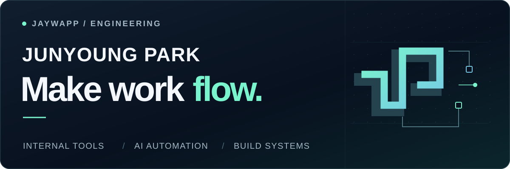

  <picture>
    <source media="(max-width: 600px)" srcset="docs/assets/profile/hero-mobile.svg" />
    
  </picture>

**Software Engineer · Developer Productivity & Tooling**

**게임 개발팀이 게임에 집중할 수 있도록, 도구와 환경을 만드는 엔지니어 박준영입니다.**

사내 웹 시스템과 게임 스크립트 도구부터 빌드팜, 업무 자동화, AI 활용 환경까지 개발팀에 필요한 기술 기반을 만들고 개선합니다. 
기획자·개발자의 요청을 해결하고, 반복되는 불편을 찾아 개선을 제안합니다.

I build internal tools, build infrastructure, and AI-assisted workflows that help game development teams focus on making games.

**[Portfolio](https://jaywapp.github.io/ko/) · [Writing](https://jaywapp.tistory.com/) · [LinkedIn](https://www.linkedin.com/in/jaywapp16/) · [Email](mailto:jaywapp16@gmail.com)**

---

## What I work on

| Focus | Work |
| :--- | :--- |
| **Internal tools** | 사내 웹 솔루션 구조 개편·리팩토링 · 게임 스크립트 전용 도구 개발 |
| **Build & infrastructure** | TeamCity 게임 빌드팜 · 리버스 프록시 기반 웹 접근 구조 정리 · 서버 구성 |
| **AI workflows** | 사내 AI 활용 환경(AX) 개선 · AI 기반 크래시 분석 흐름 구축 |
| **Workflow automation** | Slack 봇 개발 · 팀 업무 흐름 개선 |

**Technical background** 
C# · .NET · WPF · TypeScript · React · Next.js · Node.js 
Perforce · TeamCity · Claude Code · Codex · MCP · Agent harness

## Experience

**Smilegate** · Game Development Team 
Jul 2023 — Present 
사내 도구·시스템, 빌드 환경, AI 업무 흐름 개발 및 개선

**Pentacube** · Windows Client Software Developer 
Mar 2017 — Jun 2023

## Projects

[KeyMan](https://github.com/jaywapp/key-man) · [CC JSONL Monitor](https://github.com/jaywapp/cc-jsonl-monitor) · [p4-harness](https://github.com/jaywapp/p4-harness) · [jaywapp-libs](https://github.com/jaywapp/jaywapp-libs)

[Marvelog](https://marvelog.kr/) · [Gyungchung FC](https://gyungchung.vercel.app) · [Project archive](https://github.com/jaywapp/projects)

---

**Less repetitive work. More meaningful engineering.** 
반복은 자동화하고, 사람은 더 가치 있는 문제에 집중할 수 있도록.
